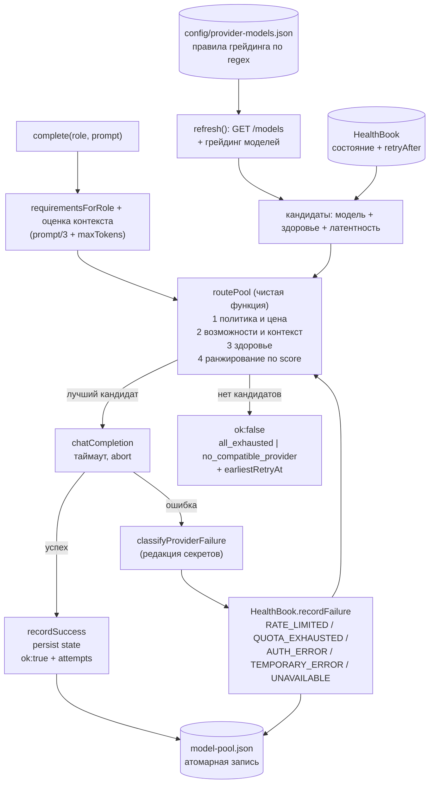
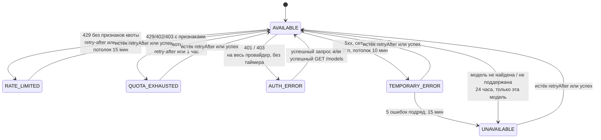

# model-pool

**English summary.** `model-pool` is a small TypeScript library that routes
text-completion requests across several free / free-tier LLM API providers
(any OpenAI-compatible `/chat/completions` endpoint). Requests are filtered by
policy, price and capability, then ranked by a deterministic score; every
provider failure is classified (rate limit, quota, auth, outage, bad request)
and fed into a persisted health model with retry times, so the pool falls back
to the next model instead of failing. Paid models are never selected, secrets
are redacted from everything that leaves the process. It was extracted from an
internal tooling monorepo; it is tested against a mocked transport only (no
live provider was called while preparing this repository). `npm test`
(136 tests), `npm run typecheck`, `npm run build` and an offline
`npm run demo` are provided.

---

## 1. Проблема и для кого

Автоматизация на LLM упирается в квоты: у бесплатных тарифов провайдеров
жёсткие лимиты по запросам и токенам, они сбрасываются в разное время, а
ответы об ошибках у каждого провайдера выглядят по-своему (`429` может
означать и «подожди 30 секунд», и «дневная квота кончилась до завтра»).
Скрипт, который привязан к одному провайдеру, просто падает посреди работы.

`model-pool` решает одну задачу: **взять текстовый запрос и обслужить его
любой доступной бесплатной моделью, не потратив деньги и не утекая ключами**.

Для кого: разработчик, у которого есть несколько бесплатных ключей и
автоматизация (ревью, планирование, суммаризация, ресёрч), которая должна
пережить исчерпание квоты у одного из провайдеров. Это библиотека, а не
сервис: нет HTTP-сервера, очереди и UI.

## 2. Как устроено

Один HTTP-клиент на все провайдеры (OpenAI-совместимый `/chat/completions`);
различия между провайдерами живут в данных (`config/provider-models.json`), а
не в коде.



Состояния здоровья и переходы (константы из `src/health.ts`):



Модули (`src/`):

| Файл | Ответственность |
| --- | --- |
| `pool.ts` | `ModelPool`: `refresh`, `complete` (с фолбэком), `completeOn` (один вызов на конкретную модель), `validate`, `snapshot`, `capacity` |
| `router.ts` | `routePool`: фильтры и скоринг, чистая детерминированная функция |
| `health.ts` | `HealthBook`: состояния, бэкоффы, ленивое истечение, сериализация |
| `errors.ts` | классификация ответов провайдера, разбор `retry-after` / `x-ratelimit-reset-*` |
| `catalog.ts` | схема каталога (zod), извлечение списка моделей из ответов разных провайдеров, грейдинг |
| `client.ts` | единственный транспорт: `chatCompletion`, `getJson` |
| `secrets.ts` | загрузка `.env`, редактор секретов |
| `fallback.ts` | обвязка «внешний агент -> пул» для ревью и планирования |
| `status.ts` | текстовый статус и таблица валидации |
| `runtime.ts` | `openModelPool`: сборка пула из каталога, `.env` и переменных окружения |
| `quota.ts`, `atomic-file.ts`, `effort.ts`, `json.ts` | вспомогательное |

## 3. Ключевые решения и почему

- **Выбор по возможностям и цене, а не round-robin.** Запрос сначала
  отсекается политикой (платные и неклассифицированные модели недоступны),
  потом требованиями роли (минимальный уровень coding/reasoning, размер
  контекста, tools, structured output), потом здоровьем. Оставшиеся
  ранжируются: качество 60, цена 20, латентность 8, остаток квоты по
  заголовкам `x-ratelimit-*` 7, «уже отвечала успешно» 5 (константы в
  `src/router.ts`). Одинаковые входы дают одинаковое решение; порядок
  кандидатов на результат не влияет.
- **Неизвестное считается небезопасным.** Модель, не подошедшая ни под одно
  правило каталога и не помеченная провайдером как бесплатная, получает цену
  `unknown` и приравнивается к платной; неизвестный размер контекста не
  проходит проверку на контекст. Платные расходы не включаются переменной
  окружения (проверено тестом в `test/runtime.test.ts`); у `openModelPool`
  такой опции нет. Включить их можно только явно, передав `policy` в
  `createModelPool`.
- **Модели не зашиты в код.** Каталог содержит regex-правила грейдинга;
  переименование или новая модель - правка JSON. Каталог проверяется zod-схемой
  при загрузке.
- **Ошибки нормализуются в семь категорий.** Квота, rate limit, авторизация,
  «модель не поддерживается», временная ошибка, плохой запрос, неизвестная -
  с разным поведением. `bad_request` не считается свидетельством о здоровье
  провайдера, а три таких отказа в одном запросе прекращают перебор
  (одинаковый запрос везде упадёт одинаково).
- **Время сброса сохраняется.** У каждого блокирующего состояния есть
  `retryAfter`; истёкший сброс снимает блокировку лениво, без таймеров и
  фоновых задач. Поэтому состояние можно записать на диск и поднять после
  перезапуска (`test/persistence.test.ts` проверяет это на синтетической
  фикстуре).
- **Секреты не покидают память.** Значения ключей редактируются из логов,
  сообщений об ошибках и сохранённого состояния: по значению, по
  `Bearer ...`, по формам известных префиксов ключей и по параметрам
  `?key=` / JSON-полям. В сохранённом состоянии - только такие уже
  отредактированные, обрезанные до 240 символов сообщения.
- **Явное различие «ждать» и «не подходит».** `all_exhausted` (стоит ждать,
  есть `earliestRetryAt`) отдельно от `no_compatible_provider` (ждать
  бесполезно); вызывающий код решает, ждать ли.
- **Внешние зависимости инвертированы.** `fetch`, часы, хранилище состояния и
  лог передаются снаружи, поэтому весь пул тестируется без сети и без
  реального времени.
- **Атомарная запись состояния.** Запись через временный файл и `rename`
  с повторами на `EPERM/EBUSY/EACCES` (типичная гонка на Windows).

## 4. Результаты и цифры

Все числа измерены в этом репозитории (`npm test`, `wc -l`):

| Показатель | Значение |
| --- | --- |
| Тесты | **136 passed / 136**, 11 файлов |
| Из них перенесены из исходного репозитория | 132 (все `it(...)` модулей пула + `quota` + `atomic-file`, кроме двух тестов очистки временных файлов, которые не нужны пулу) |
| Добавлено при выделении | 4 (персистентность на фикстуре, смена каталога состояния, повреждённый файл состояния, разбор JSON) |
| Код `src/` | 3455 строк, 16 файлов |
| Тесты `test/` | 2967 строк |
| Каталог провайдеров | 12 провайдеров, 69 правил грейдинга (`config/provider-models.json`) |
| Рантайм-зависимости | 1 (`zod`) |
| `npm run typecheck` | чисто, strict + `exactOptionalPropertyTypes` + `noUncheckedIndexedAccess` |

Тесты используют подставной `fetch`: проверяются классификация ответов,
фолбэк между провайдерами, учёт `retry-after`, редакция секретов, восстановление
состояния, политика цены. Живые провайдеры тестами **не** проверяются.

## 5. Ограничения и что дальше

Честно о том, чего здесь нет или что не проверено:

- **Живые провайдеры не проверялись.** При подготовке репозитория ни один
  реальный запрос не отправлялся. Формы ответов (`/models`, заголовки
  rate-limit, тексты ошибок) взяты из кода исходного проекта и подставных
  ответов в тестах; реальное поведение провайдеров может отличаться.
  `npm run demo:live` для такой проверки написан, но не запускался с ключами.
- **Каталог - снимок допущений.** Что модель «бесплатная» и какого она
  уровня (coding/reasoning 0-3), задано вручную regex-правилами и описывает
  условия на момент написания; условия free-тарифов провайдеров меняются.
  Проверять каталог перед использованием нужно самостоятельно.
- Только текст на входе и выходе: одно пользовательское сообщение,
  без стриминга, системного промпта, tool calling и multimodal.
  Оценка контекста грубая (`длина промпта / 3`).
- Фиксированный набор ролей (`qa_review`, `planning`, `research`,
  `summarization`); новая роль требует правки `router.ts`.
- Состояние - один JSON-файл и один процесс-владелец; межпроцессной
  синхронизации нет (только очередь записи внутри процесса).
- Реактивная модель: лимиты узнаются из ошибок и заголовков, а не из
  предварительного учёта токенов; проактивного rate limiter нет.
- Нет CLI и нет публикации в npm (`private: true`).
- Роли и пороги качества в `fallback.ts` (`qa_review`, `maxTokens: 8192`
  для планирования) - значения исходного проекта, не универсальные.

Возможные следующие шаги (не сделано): запуск `demo:live` на реальных ключах
и сверка каталога, оценка токенов настоящим токенизатором, пользовательские
роли, межпроцессная блокировка состояния.

## 6. Как запустить

Требуется Node.js >= 20.3 (проверено на Node 24 под Windows).

```bash
npm install
npm test            # 136 тестов, без сети
npm run typecheck
npm run build       # dist/
npm run demo        # офлайн-демо на моках
```

`npm run demo` показывает на подставном транспорте (вымышленные провайдеры,
ключи-заглушки, без сети и без записи на диск): ранжирование и отбраковку
платной модели, фолбэк при `429` с `retry-after`, фолбэк при исчерпании квоты,
`all_exhausted` со временем восстановления, липкое состояние `AUTH_ERROR`,
восстановление по времени и переход «внешний агент упёрся в квоту -> пул».

### С реальными ключами

```bash
cp .env.example .env     # впишите свои ключи (файл в .gitignore)
npm run demo:live            # только список моделей, токены не тратятся
npm run demo:live -- --ask   # плюс один небольшой запрос через пул
```

Использование как библиотеки:

```ts
import { openModelPool } from "./src/index.js"; // или из dist/ после build

const { pool, enabled } = await openModelPool(process.cwd());
if (enabled) {
  await pool.refresh(); // список моделей, токены не тратятся
  const result = await pool.complete({ role: "summarization", prompt: "..." });
  if (result.ok) console.log(result.provider, result.model, result.text);
  else console.log(result.reason, result.earliestRetryAt);
}
```

Настройка:

| Что | Как |
| --- | --- |
| Ключи | `.env` / `.env.local` в корне или переменные окружения; имена - поле `envKeys` каталога |
| Внешний файл ключей | `MODEL_POOL_ENV_FILE=путь` |
| Выключить пул | `MODEL_POOL=off` (`opened.enabled === false`) |
| Выключить провайдеров | `MODEL_POOL_DISABLED=groq,mistral` |
| Каталог | `catalogPath` в `openModelPool` (по умолчанию `config/provider-models.json`) |
| Каталог состояния | `stateDirectory` (по умолчанию `.model-pool/`) |

## 7. Моя роль

Продуктовая постановка, архитектура и приёмка — мои. Код написан ИИ-агентами (Claude, Codex) под моим управлением.

Как владельцем, мной определены: какие
задачи должен решать пул, правило «никаких платных расходов и утечек ключей»,
выбор стратегии (политика -> возможности -> здоровье -> скоринг, явное
различие «ждать»/«не подходит»), требования к тестам и критерии готовности.
выделение модуля из монорепо, обобщение и перенос тестов выполнены так же.
Поэтому в разделе «Ограничения» отдельно отмечено, что именно не проверялось
на живых провайдерах.

Происхождение: модуль выделен из внутреннего монорепо (ветка `test-launch`,
коммит `4dde6e7`, файлы `model-pool*.ts`, `provider-models.json` и их тесты);
исходный репозиторий не изменялся.

## Связанные репозитории

- [developer-factory-case](https://github.com/potia-byte/developer-factory-case) — архитектура системы ИИ-агентов, частью которой был этот модуль
